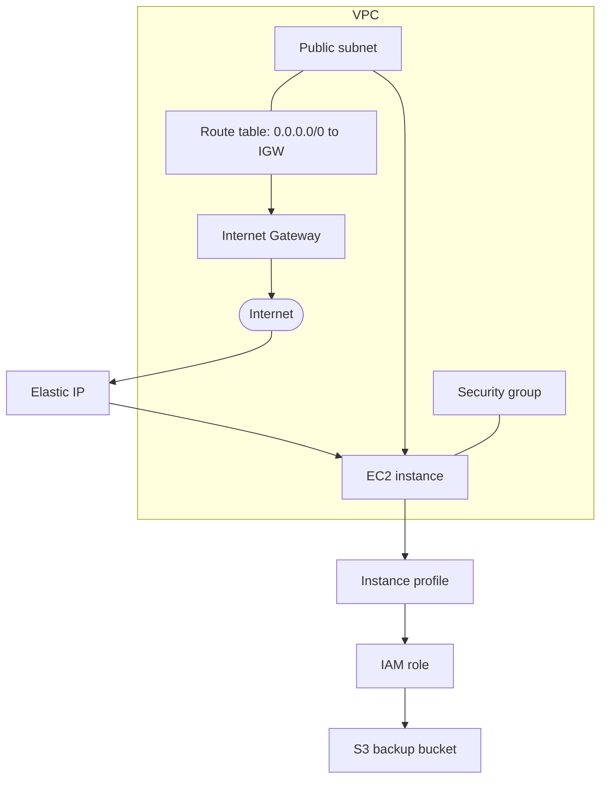

前一篇 [OpenTofu 入门](../opentofu.md) 介绍了 IaC、Provider、Resource 和 State 等概念。本文从一个实际运行的 AWS 项目里抽取一条更具体的路径：用 OpenTofu 管理网络、EC2、IAM 和 S3，再用 Ansible 配置实例里的软件。

文中的资源名称、区域和变量值都使用示意值，代码是为解释结构整理的片段，不是可直接部署的完整配置。实际项目还包含 ECR、GitHub Actions OIDC、Lambda、Scheduler、SQS、SNS 和 CloudWatch 告警等资源。

## 先划分管理边界

这套项目把「云上资源」和「操作系统里的配置」交给不同工具：

| 工具 | 管理内容 | 例子 |
| --- | --- | --- |
| OpenTofu | AWS API 管理的资源 | VPC、子网、路由、安全组、EC2、IAM Role、S3、ECR |
| Ansible | 已创建主机内的软件和配置 | 软件安装、服务配置、应用运行环境 |

OpenTofu 负责让 AWS 资源达到配置里声明的状态；Ansible 连接到已存在的主机，配置主机内部。实例 IP、IAM Role 等由 OpenTofu 创建的属性可以作为后续运维所需的信息。这样，基础设施生命周期和机器配置各有明确边界。

## 资源之间如何连起来

一台对外提供 Web 服务的 EC2，并不是一个独立资源。它需要 VPC、子网、Internet Gateway、路由表、安全组、实例配置和 IAM 权限共同组成：



配置中的引用既表达了关联，也让 OpenTofu 推导资源依赖。例如，子网引用 VPC ID，路由引用 Internet Gateway，EC2 引用子网和安全组：

```hcl
resource "aws_vpc" "app" {
  cidr_block = "10.20.0.0/16"
}

resource "aws_subnet" "public" {
  vpc_id                  = aws_vpc.app.id
  cidr_block              = "10.20.1.0/24"
  map_public_ip_on_launch = true
}

resource "aws_internet_gateway" "app" {
  vpc_id = aws_vpc.app.id
}

resource "aws_route_table" "public" {
  vpc_id = aws_vpc.app.id

  route {
    cidr_block = "0.0.0.0/0"
    gateway_id = aws_internet_gateway.app.id
  }
}

resource "aws_route_table_association" "public" {
  subnet_id      = aws_subnet.public.id
  route_table_id = aws_route_table.public.id
}
```

这里不需要手动规定创建顺序。`aws_subnet.public` 对 VPC 的引用，以及路由表对 Internet Gateway 的引用，都会形成依赖关系；OpenTofu 按依赖图安排操作。

## 用远程 Backend 保存 State

State 记录 OpenTofu 管理的资源及其属性。实际配置把每套资源的 State 放在 S3，而不是开发者电脑的本地目录：

```hcl
terraform {
  required_version = ">= 1.6"

  required_providers {
    aws = {
      source  = "hashicorp/aws"
      version = "~> 5.0"
    }
  }

  backend "s3" {
    bucket = "example-tofu-state"
    key    = "aws/app/terraform.tfstate"
    region = "ap-southeast-1"
  }
}

provider "aws" {
  region = "ap-northeast-1"
}
```

这两个区域的配置作用不同：`backend "s3"` 中的 `region` 是 State bucket 所在区域；`provider "aws"` 中的 `region` 是这套配置管理 AWS 资源时使用的区域。

Backend bucket 需要先准备好，再初始化使用它的配置目录。State 可能包含资源属性和敏感值，因此不能提交到 Git；远程 bucket 也需要按 State 的敏感级别设置访问权限、加密、版本保留和恢复流程。把 State 放到 S3 不会自动替代这些保护措施。

Provider 版本约束表达允许使用的版本范围，`.terraform.lock.hcl` 则记录实际解析到的版本和校验信息，通常应该提交。`.terraform/` 是本地初始化缓存，不应提交。团队成员操作同一套资源时还要确认 Backend 的锁机制配置和实际行为；不能把本地并行执行 `apply` 当作安全的协作方式。

## 让 EC2 通过 Instance Profile 获得权限

应用需要把备份写入 S3 时，可以让 EC2 使用 Instance Profile 携带的 IAM Role，而不是把长期 AWS Access Key 放进应用配置：

```hcl
resource "aws_iam_role" "app" {
  name = "example-app-role"

  assume_role_policy = jsonencode({
    Version = "2012-10-17"
    Statement = [{
      Effect    = "Allow"
      Principal = { Service = "ec2.amazonaws.com" }
      Action    = "sts:AssumeRole"
    }]
  })
}

resource "aws_iam_role_policy" "backup" {
  name = "example-app-backup"
  role = aws_iam_role.app.id

  policy = jsonencode({
    Version = "2012-10-17"
    Statement = [{
      Effect = "Allow"
      Action = ["s3:PutObject", "s3:GetObject"]
      Resource = [
        "${aws_s3_bucket.backup.arn}/app/*"
      ]
    }]
  })
}

resource "aws_iam_instance_profile" "app" {
  name = "example-app-profile"
  role = aws_iam_role.app.name
}

resource "aws_instance" "app" {
  ami                    = var.ami_id
  instance_type          = var.instance_type
  subnet_id              = aws_subnet.public.id
  vpc_security_group_ids = [aws_security_group.app.id]
  iam_instance_profile   = aws_iam_instance_profile.app.name
}
```

Role 的信任策略回答「谁能扮演这个 Role」，权限策略回答「扮演后能做什么」。`aws_iam_instance_profile` 把 Role 关联给 EC2；应用通过 AWS SDK 的默认凭证链取得临时凭证。S3 权限示例只针对备份对象路径，具体 Action 和 Resource 应按应用实际操作收窄。

实际实例要求通过 IMDSv2 取得实例角色凭证。容器内的进程通过实例元数据服务取凭证时，容器网络会增加一跳；如果相应的 hop limit 不合适，容器可能无法取得 Role 凭证。这类运行时细节需要结合容器网络验证，不只是写好 IAM Policy 就结束。

## 输入值与安全组

机器相关的输入放在变量里；本地使用的 `terraform.tfvars` 不提交，仓库可以提供不含真实值的 `terraform.tfvars.example`：

```hcl
variable "ami_id" {
  description = "Pinned Amazon Linux AMI ID for the target region"
  type        = string
}

variable "instance_type" {
  type    = string
  default = "t3a.small"
}

variable "admin_cidr" {
  description = "Trusted source CIDR for administrative access"
  type        = string
}
```

AMI ID 在这里显式固定，避免每次查询到新 AMI 后都意外触发实例替换。更新系统镜像时，可以先确认目标区域的 AMI，再有意识地修改变量并审阅 `plan`。

安全组示例将管理入口限制到调用者指定的 CIDR；Web 端口是否向公网开放，则按服务需要配置：

```hcl
resource "aws_security_group" "app" {
  name   = "example-app"
  vpc_id = aws_vpc.app.id

  ingress {
    description = "SSH from trusted network"
    from_port   = 22
    to_port     = 22
    protocol    = "tcp"
    cidr_blocks = [var.admin_cidr]
  }

  ingress {
    description = "HTTPS"
    from_port   = 443
    to_port     = 443
    protocol    = "tcp"
    cidr_blocks = ["0.0.0.0/0"]
  }

  egress {
    from_port   = 0
    to_port     = 0
    protocol    = "-1"
    cidr_blocks = ["0.0.0.0/0"]
  }
}
```

这段是为公开讲解整理过的示例，不保证与当前生产环境的每条规则完全一致。管理端口不应默认面向整个互联网；也可以考虑用 AWS Systems Manager Session Manager 管理实例，减少 SSH 暴露和密钥分发。

## 从 `plan` 到 `apply`

日常操作在对应的 OpenTofu 配置目录中执行：

```bash
tofu init
tofu fmt -check
tofu validate
tofu plan
tofu apply
```

- `init` 初始化 Backend 并安装 Provider。
- `fmt` 检查 HCL 格式；`validate` 检查配置结构。
- `plan` 对照配置、State 和 AWS 当前资源，显示预计新增、修改、删除或重建的内容。
- `apply` 执行变更。执行前检查 Plan，特别留意实例替换、网络入口变化和 IAM 权限扩大。

实例类型等属性有时可以原地更新，有时资源属性变化会要求重建。具体行为取决于资源和 Provider；`plan` 才是本次变更的依据。`apply` 不是「把文件上传到 AWS」，而是按依赖图执行一系列 API 操作。

## GitHub Actions 使用 OIDC

生产项目的另一部分是构建和部署流水线。GitHub Actions 可通过 OIDC 向 AWS 请求短期身份，再扮演一个权限受限的 IAM Role，不必把长期 AWS Access Key 保存到 GitHub Secrets。

AWS Role 的信任策略应限制 OIDC audience 和可接受的仓库身份，例如只允许特定仓库的 tag 工作流：

```hcl
Condition = {
  StringEquals = {
    "token.actions.githubusercontent.com:aud" = "sts.amazonaws.com"
  }
  StringLike = {
    "token.actions.githubusercontent.com:sub" = [
      "repo:OWNER/REPOSITORY:ref:refs/tags/*"
    ]
  }
}
```

随后给该 Role 只授予流水线所需的操作，例如向指定 ECR Repository 推送镜像；部署时通过 Systems Manager 发送命令。若 GitHub Actions Job 使用了 GitHub Environment，OIDC 的 `sub` 形状会与普通 tag/ref Job 不同，信任策略要针对实际 claims 配置。工作流本身还需声明 `id-token: write`。仓库、tag、Environment 和权限范围都应按实际工作流收窄。

## 这套做法的取舍

把 AWS 资源写成代码后，资源关系、权限和变更可以审查与复现；但这也意味着 State、凭证边界、Provider 版本、资源替换和 IAM Policy 都成为项目维护的一部分。

在这个项目里，我更看重几个具体结果：网络和实例配置能从代码追溯；EC2 和 CI 使用短期 Role 凭证而非长期密钥；应用服务器的配置继续由 Ansible 管理；每次基础设施修改先通过 `plan` 阅读影响范围。对于资源较少的单机应用，这套结构仍需要维护 Backend 和 IAM；随着备份、镜像仓库和告警等资源加入，代码化的关联关系也更容易审阅。

进一步了解 OpenTofu 的 Resource、State、Backend 和命令说明，可继续看[入门文档](../opentofu.md)；AWS IAM 的身份与 Role 概念见 [AWS IAM](./iam.md)。
