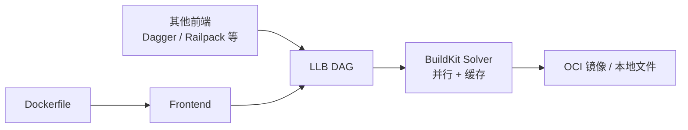

## 问题从哪来

构建容器镜像，最常见的做法是写一个 Dockerfile（或 Containerfile），交给 BuildKit、Buildah、Kaniko 之类的构建器执行。Cloud Native Buildpacks（CNB）则不需要 Dockerfile：把源码或 jar 交给 builder，自动产出 OCI 镜像。

既然 Dockerfile 已经能构建任意镜像，为什么还会出现 CNB？它解决的是 Dockerfile 解决不了的问题，还是别的问题？本文把这几个问题放在一起整理。CNB 的概念与 Paketo 用法见 [CNB: Cloud Native Buildpacks 与 Paketo](./cloud-native-buildpacks.md)，Dockerfile 写法见 [Containerfile](../inbox/container-file.md)。

先说结论：CNB 主要解决的不是「单个镜像能不能构建出来」，而是「几百上千个应用的镜像由谁来写、怎么统一、基础镜像出漏洞后怎么批量修」。这是组织规模上的问题，不是 Dockerfile 语法能力上的问题。

## BuildKit 是什么

BuildKit 是 Moby 项目下的构建引擎，Docker Engine 23.0 起在 Linux 上成为 `docker build` 的默认后端，`docker buildx` 也基于它。

一个常被忽略的点：BuildKit 本身并不依赖 Dockerfile。它的结构分两层：

- 前端（frontend）：把某种构建描述翻译成 LLB（Low-Level Build definition，一种描述构建步骤的有向无环图）。Dockerfile 只是其中一个前端，Dockerfile 首行的 `# syntax=docker/dockerfile:1` 指定的就是前端镜像。
- 求解器（solver）：执行 LLB，负责并行、缓存、导出镜像。



所以更准确的说法是：「Dockerfile 是一种构建描述语言，BuildKit 是执行引擎」。Dagger 的引擎、Railway 的 Railpack 等工具都直接生成 LLB，不写 Dockerfile 也能用 BuildKit。

### 不写 Dockerfile 时，基础镜像和步骤写在哪

基础镜像、编译步骤、多阶段构建这些信息不会消失，只是换了地方表达。Dockerfile 指令和 LLB 操作大致一一对应：

| Dockerfile 指令 | LLB 操作（Go SDK） |
| --------------- | ------------------ |
| `FROM golang:1.23` | `llb.Image("golang:1.23")` |
| `RUN go build` | `.Run(llb.Shlex(...))` |
| `COPY --from=build` | `llb.Copy(build, ...)` |

不写 Dockerfile 的常见方式有三种。

第一种，用 BuildKit 的 Go SDK 直接生成 LLB，两阶段构建同样能表达，生成的定义交给 `buildctl build` 执行：

```go
// build stage: compile in golang image
build := llb.Image("golang:1.23").
    Dir("/src").
    Run(llb.Shlex("go build -o /out/app .")).Root()

// runtime stage: copy binary into alpine
runtime := llb.Image("alpine:3.20").
    File(llb.Copy(build, "/out/app", "/app"))
```

第二种，用更高层的工具，例如 Dagger，用 Go / TypeScript / Python 写构建流程，底层仍是 BuildKit：

```typescript
// Dagger pipeline: base image and steps are defined in code
dag.container().from("node:22")
  .withDirectory("/app", src)
  .withExec(["npm", "ci"])
  .withExec(["npm", "run", "build"])
```

第三种，由工具自动检测项目再生成 LLB，例如 Railpack：看到 `package.json` 就按 Node 项目处理，基础镜像和步骤来自工具的默认规则，用户在配置文件里覆盖。

也就是说，基础镜像和步骤要么写在代码里，要么写在另一种配置格式里，要么由工具约定。Dockerfile 只是其中一种写法。

需要说明的是，直接写 LLB 在实际项目里很少见，主要是构建工具作者在用，见下文 §认可度。

相比旧版 `docker build`，BuildKit 带来的主要能力：

| 能力 | 说明 |
| ---- | ---- |
| 并行构建 | 多阶段构建中互不依赖的 stage 并行执行 |
| 缓存挂载 | `RUN --mount=type=cache` 让 Maven、Go module 等缓存跨构建复用 |
| 密钥挂载 | `RUN --mount=type=secret` 构建时用密钥，不写进镜像层 |
| 远程缓存 | `--cache-to` / `--cache-from` 把缓存放到 registry，CI 节点之间共享 |
| 多架构 | `buildx build --platform linux/amd64,linux/arm64` |
| 供应链元数据 | v0.11 起支持 SBOM 与 SLSA provenance attestation |
| 可复现 | 支持 `SOURCE_DATE_EPOCH` 固定时间戳 |

一个典型的 BuildKit 风格 Dockerfile：

```dockerfile
# syntax=docker/dockerfile:1
FROM golang:1.23 AS build
WORKDIR /src
COPY go.mod go.sum ./
RUN --mount=type=cache,target=/go/pkg/mod go mod download
COPY . .
RUN --mount=type=cache,target=/root/.cache/go-build \
    CGO_ENABLED=0 go build -o /out/app .

FROM gcr.io/distroless/static-debian12
COPY --from=build /out/app /app
USER nonroot
ENTRYPOINT ["/app"]
```

```bash
# build multi-arch image with registry cache and attestations
docker buildx build \
  --platform linux/amd64,linux/arm64 \
  --cache-to type=registry,ref=registry.example.com/app:cache,mode=max \
  --cache-from type=registry,ref=registry.example.com/app:cache \
  --sbom=true --provenance=true \
  -t registry.example.com/app:1.0 --push .
```

## Dockerfile 在规模化时的问题

单看一个项目，Dockerfile 几乎没有做不到的事：任意基础镜像、任意系统包、任意目录布局。问题出在「每个应用一份 Dockerfile」这件事放大之后。

### 1. 每个团队各写一份，质量参差

同样是 Spring Boot 服务，有人用 `openjdk` 全量 JDK 做运行镜像，有人以 root 运行，有人把 fat jar 整个 `COPY` 成一层导致依赖层无法缓存，有人忘了设置 JVM 内存参数。Dockerfile 是命令式脚本，正确性完全取决于写的人。平台团队很难在不读每一份 Dockerfile 的前提下保证基线。

### 2. 基础镜像出漏洞，要逐个重建

基础镜像（OS 层、JRE）发布安全补丁时，用 Dockerfile 的流程是：更新 `FROM` 标签或等待 tag 漂移 → 每个应用重新跑一遍构建 → 重新测试 → 重新发布。几百个应用就是几百次完整构建，其中大部分应用代码根本没变。

### 3. 构建逻辑与应用耦合

Dockerfile 放在应用仓库里，构建知识（用哪个 JRE、怎么分层、启动参数）散落在每个仓库。想统一升级 Java 版本或换基础镜像发行版，需要给每个仓库提 PR。

### 4. 缓存语义基于指令顺序

Dockerfile 的层缓存按指令顺序失效：某一行变了，后面全部重建。合理分层依赖写的人对缓存机制的理解；BuildKit 的缓存挂载缓解了很多，但仍要手动写对。

## CNB 怎么回应这些问题

CNB 由 Pivotal 与 Heroku 在 2018 年发起，同年进入 CNCF sandbox，2020 年升为 incubating。它的思路来自 Heroku 和 Cloud Foundry 多年的 PaaS 实践：开发者只推代码，平台负责把代码变成可运行的东西。

| Dockerfile 的问题 | CNB 的做法 |
| ----------------- | ---------- |
| 各写各的，质量参差 | 构建逻辑集中在 buildpack 里，由平台团队或社区（如 Paketo）维护；应用侧只配 `BP_*` 环境变量 |
| 基础镜像漏洞要逐个重建 | `rebase`：只替换镜像底部的 run image 层，应用层不动，不需要重新构建 |
| 构建逻辑与应用耦合 | 构建知识在 builder 镜像里，升级 builder 版本即可统一变更 |
| 缓存依赖手写顺序 | buildpack 按语义（依赖、JRE、应用）贡献独立层，并能在构建间恢复缓存层 |
| 安全基线 | 构建与运行默认非 root；镜像内带 SBOM；时间戳固定以便复现 |

### rebase：CNB 最独特的能力

CNB 镜像的结构是固定的：底部是 run image（OS + 基础库），上面是 buildpack 贡献的层（JRE、依赖、应用）。CNB 规范要求 run image 的更新保持 ABI 兼容，因此当 run image 发布补丁时，可以直接在 registry 层面改写镜像 manifest，把底部几层换成新版本：

```bash
# swap the run image layers in place; app layers stay untouched
pack rebase registry.example.com/app:1.0 --run-image paketobuildpacks/run-noble-base:latest
```

这个操作只涉及 manifest 和 layer 引用，通常几秒完成，不跑构建、不下载应用依赖。配合 [kpack](https://github.com/buildpacks-community/kpack) 这类 K8s 控制器，可以在 run image 更新后自动对所有镜像执行 rebase。

Dockerfile 镜像理论上也能做类似操作（例如 `crane rebase`），但 Dockerfile 没有约定哪几层是「基础」、哪几层依赖基础层里的文件；`RUN apt-get install` 产生的层可能与旧基础层紧耦合，替换后是否还能运行没有保证。CNB 的 rebase 安全，是因为镜像结构和 ABI 兼容性由规范约束。

### 回到问题：Dockerfile 有解决不了的问题吗

单个镜像的层面上，没有。Dockerfile 能表达的东西比 CNB 多：CNB 能做出来的镜像，手写 Dockerfile 都能做出来，反之不成立。

CNB 解决的是另一类问题：

- 把「怎么构建镜像」从每个应用里抽出来，变成平台统一维护的能力
- 让基础镜像修补从「重建所有应用」变成「rebase 所有镜像」
- 让镜像结构可预测，从而可以被工具批量治理

这些问题用 Dockerfile 也能部分缓解（公司统一模板、共享基础镜像、Renovate 自动提 PR、BuildKit 的 SBOM），但需要自己搭体系；CNB 把这套体系标准化了。

另外要注意，Dockerfile 与 BuildKit 这几年也在补短板：SBOM、provenance、可复现时间戳、远程缓存都已经有了。两者在供应链元数据上的差距已明显缩小，CNB 剩下最主要的差异是 rebase 和「应用侧零构建脚本」。

## 不经过 BuildKit：直接组装镜像

还有一类工具连 BuildKit 都不用，典型是 Go 的 [ko](https://ko.build/)、Java 的 Jib、Chainguard 的 apko。

容器镜像本质上是几个 tar 包（层）加 JSON（manifest 与 config）。Dockerfile 需要容器，是因为 `RUN` 要在容器里执行命令；如果产物在宿主机上就能编出来，就不需要这一步。ko 的流程：

1. 在本机执行 `go build`，得到静态二进制
1. 把二进制打成一个 tar 层
1. 叠在基础镜像上，生成 manifest，直接推送到 registry

整个过程没有容器、没有 BuildKit。基础镜像默认是 `cgr.dev/chainguard/static`，可在 `.ko.yaml` 中修改：

```yaml
# .ko.yaml
defaultBaseImage: cgr.dev/chainguard/static:latest
```

```bash
# build and push without Dockerfile or container runtime
KO_DOCKER_REPO=registry.example.com/team ko build ./cmd/app
```

ko 能做到这么简单，前提是 Go 能编出不依赖其他文件的静态二进制。Jib 同理，它知道 Java 应用由依赖 jar、资源文件、class 文件组成，直接按这个结构分层。

## 前端项目怎么办

据我所知，前端领域没有像 ko 那样专门为前端打镜像、又被广泛使用的工具。原因是 JS 项目没有「一个静态二进制」：SSR 需要 Node 运行时和 `node_modules`，SPA 需要一个 Web 服务器托管静态文件。可选方案分两种情况。

### React SPA

Vite 等构建后的产物只是 `dist/` 静态文件，镜像就是 nginx 或 Caddy 加上这些文件。不写 Dockerfile 的选项：

- Paketo（CNB）：Node.js buildpack 执行 `npm run build`，Web Servers buildpack 打进 nginx
- Railpack：能识别 Vite 这类静态站点，自动用 Caddy 托管

```bash
# BP_WEB_SERVER_ENABLE_PUSH_STATE falls back all routes to index.html
pack build my-spa --builder paketobuildpacks/builder-jammy-base \
  --env BP_WEB_SERVER=nginx \
  --env BP_WEB_SERVER_ROOT=dist \
  --env BP_WEB_SERVER_ENABLE_PUSH_STATE=true
```

`BP_WEB_SERVER_ENABLE_PUSH_STATE=true` 用于前端路由（history 模式），否则刷新非根路径会 404。

实际项目里这种场景更多人还是写一个很短的两阶段 Dockerfile，因为足够简单：

```dockerfile
FROM node:22 AS build
WORKDIR /app
COPY package*.json ./
RUN npm ci
COPY . .
RUN npm run build

FROM nginx:alpine
COPY --from=build /app/dist /usr/share/nginx/html
```

### Next.js SSR

最接近 ko「单一产物」思路的是 Next.js 自带的 standalone 输出：

```js
// next.config.js
module.exports = { output: 'standalone' }
```

`next build` 后生成 `.next/standalone/`，包含 `server.js` 和裁剪过的最小 `node_modules`，运行时只需要 Node。之后两种做法：

- 写一个简短 Dockerfile，参考 Next.js 仓库的 `examples/with-docker`
- 不写 Dockerfile：Paketo Node.js buildpack、Heroku Node.js CNB、Google Cloud buildpacks、Railpack 都能识别 Next.js 项目，自动执行 `npm ci`、`next build`、`next start`

这些都是通用的多语言工具，不是前端专用，镜像体积和启动方式通常不如基于 standalone 自己写的 Dockerfile 精细。

纯 Node 后端（非 Next.js）还可以用 Bun 的 `bun build --compile` 或 Node 的 SEA（single executable application）编出单个可执行文件，之后就能像 ko 那样直接组装镜像；Next.js SSR 目前不适合这条路。

### 各语言汇总

| 场景 | 不写 Dockerfile 的选择 | 常见实际做法 |
| ---- | ---------------------- | ------------ |
| Go | ko | ko |
| Java | Jib、CNB | Jib 或 `bootBuildImage` |
| React SPA | Paketo Web Servers、Railpack | 两阶段 Dockerfile + nginx |
| Next.js SSR | Paketo / Heroku / Google CNB、Railpack | `output: 'standalone'` + 短 Dockerfile |

## 各自的优势与劣势

### Dockerfile + BuildKit

优势：

- 完全控制：任意基础镜像、系统包、文件布局、多阶段裁剪
- 通用：任何语言、任何奇怪的项目都能构建
- 透明：构建步骤就写在文件里，出问题容易定位
- 生态最大：几乎所有 CI、教程、工具默认支持
- 构建快且灵活：并行 stage、缓存挂载、多架构成熟

劣势：

- 每个应用要有人写、有人维护，质量依赖个人经验
- 基础镜像补丁需要重建全部应用
- 默认缺少安全基线（root 用户、大基础镜像都很常见）
- 规模大时治理成本高

### CNB（Paketo 等）

优势：

- 应用侧零 Dockerfile，主流语言自动检测
- 构建逻辑集中维护，统一升级 JRE、基础镜像
- rebase 快速修补基础层漏洞
- 镜像结构一致、默认非 root、自带 SBOM
- 对 Spring Boot 等生态集成好（`bootBuildImage`、分层 JAR）

劣势：

- 灵活度受限：需要额外系统包或特殊 OS 布局时，要自定义 run image、写自己的 buildpack 或用 image extension，成本比改一行 Dockerfile 高
- 黑盒感：出问题要理解 detect / build 顺序和 buildpack 的行为，调试门槛高
- builder 镜像体积大，首次构建要拉几百 MB 甚至更多
- 只覆盖 buildpack 支持的语言和项目形态，非常规项目不适用
- 多架构支持起步较晚，部分 builder 和 buildpack 对 arm64 的支持不如 Dockerfile 成熟
- 无 Docker daemon 环境下要直接调用 lifecycle（如 Tekton 的 buildpacks-phases），集成比 Kaniko / BuildKit 稍绕

### 选型对比

| 维度 | Dockerfile + BuildKit | CNB |
| ---- | --------------------- | --- |
| 构建描述 | 命令式脚本，应用自带 | 声明式配置，逻辑在 buildpack |
| 灵活度 | 最高 | 中，受 buildpack 能力约束 |
| 适用对象 | 任何项目 | 主流语言的标准应用 |
| 基础镜像补丁 | 重建 | rebase |
| 维护方 | 应用团队 | 平台团队 / 社区 |
| 调试 | 直观 | 需要了解 lifecycle |
| 规模化治理 | 需自建体系 | 内建 |

## 认可度：各自在哪一层

「直接写 LLB」和「CNB」常被放在一起比较，但它们不在同一层：

| 方案 | 所在层次 | 定位 | 面向谁 |
| ---- | -------- | ---- | ------ |
| Dockerfile | 构建描述语言 | 事实标准 | 应用开发者 |
| LLB | 引擎中间格式 | 实现细节 | 构建工具作者 |
| CNB | 构建约定 / 规范 | CNCF 规范 | 平台团队 + 应用开发者 |
| BuildKit | 执行引擎 | 事实标准 | 所有上层工具 |

### BuildKit 引擎：普遍认可

BuildKit 是 `docker build` / `docker buildx` 的默认后端，GitHub Actions 的 `docker/build-push-action` 和各类云构建服务底层也大多是它。但喂给它的几乎都是 Dockerfile。

### 直接写 LLB：小众

- LLB 是 BuildKit 的内部中间格式，只有 Go API，随 BuildKit 版本演进，没有独立规范，也没有多家实现
- 应用项目基本不会手写 LLB，上文的 Go 代码只用来说明原理
- 使用 LLB 的是一批构建工具：Dockerfile 前端本身、Dagger、Railpack、Microsoft 的 Dalec（用 YAML 描述构建的 BuildKit 前端）等。它们各有用户，但都不是行业标准；也有项目做了几年后停止维护，如 HLB。这类工具的命运取决于背后的公司，没有中立规范兜底

### CNB：「免 Dockerfile」方向上更被认可

- 是 CNCF incubating 项目，buildpack API、platform API 有版本化规范
- 有多家独立实现（Paketo、Heroku、Google Cloud），镜像结构一致
- 有产品级采用：Spring Boot `bootBuildImage`、Heroku 新一代平台、Google Cloud Run 源码部署
- 管的是镜像结构约定、rebase、SBOM 这类「构建约定」，而 LLB 只描述执行步骤

理论上 CNB 也能跑在 BuildKit 上（早年有实验性的 buildpacks 前端），但未成为主流；CNB 官方实现使用自己的 lifecycle，不依赖 BuildKit。

整体认可度大致是：

1. Dockerfile + BuildKit：绝对主流
1. CNB：免 Dockerfile 方向上最被认可的标准，Java/Spring 与 PaaS 场景最强；放到整个容器生态，使用率仍远低于 Dockerfile
1. ko、Jib：在各自语言内被广泛接受
1. 基于 LLB 的各类工具：小众，按工具单独评估

## 未来会朝 CNB 走吗

我的判断是：不会出现「CNB 取代 Dockerfile」，但「应用开发者少写或不写 Dockerfile」是一个明确的方向，CNB 只是这个方向上的一种实现。

从现状看：

- Dockerfile 仍是事实标准。开源项目、基础设施组件、需要定制系统环境的服务，几乎都用 Dockerfile，短期内不会改变。
- PaaS 和平台型产品倾向于隐藏构建细节。Heroku 新一代平台、Google Cloud Run 的源码部署、Spring Boot 的 `bootBuildImage` 都基于 CNB。
- 「不写 Dockerfile」还有其他路线：Go 的 [ko](https://ko.build/)、Java 的 Jib 直接从构建工具产出镜像；Railway 的 Railpack 自动检测项目后生成 BuildKit LLB；Chainguard 的 apko 用声明式配置组装最小镜像。它们不走 CNB 规范，但解决的是同一个问题。
- BuildKit 作为执行引擎的地位反而更稳：不论上层用 Dockerfile 还是其他前端，很多工具最终都在 BuildKit 上执行。

比较可能的格局：

- 标准化的业务服务（Spring Boot、Node.js、Go Web 服务），由平台统一构建，CNB 或类似工具占比会上升
- 基础设施、特殊依赖、追求极致镜像体积的场景，继续用 Dockerfile
- 两者在同一个组织里并存，按项目选择，如 Tekton 里 Kaniko 和 buildpacks-phases 并存（见 [Spring Boot Container Packaging](../language/java/spring/spring-boot-container-packaging.md)）

选择的依据主要是组织规模：应用数量少、团队熟悉 Docker 时，Dockerfile 的总成本更低；应用数量多、需要统一安全基线和快速修补时，CNB 的收益才明显。

## 参考

- [BuildKit](https://github.com/moby/buildkit)
- [Docker Build 文档](https://docs.docker.com/build/)
- [Dockerfile frontend 语法](https://docs.docker.com/reference/dockerfile/)
- [Build attestations（SBOM / provenance）](https://docs.docker.com/build/metadata/attestations/)
- [buildpacks.io](https://buildpacks.io/docs/)
- [CNB rebase](https://buildpacks.io/docs/for-app-developers/concepts/rebase/)
- [kpack](https://github.com/buildpacks-community/kpack)
- [BuildKit LLB](https://github.com/moby/buildkit#exploring-llb)
- [Dagger](https://docs.dagger.io/)
- [Railpack](https://railpack.com/)
- [ko](https://ko.build/)
- [Jib](https://github.com/GoogleContainerTools/jib)
- [Paketo Web Servers Buildpack](https://paketo.io/docs/howto/web-servers/)
- [Next.js output: standalone](https://nextjs.org/docs/app/api-reference/config/next-config-js/output)
- [CNB: Cloud Native Buildpacks 与 Paketo](./cloud-native-buildpacks.md)
- [Containerfile](../inbox/container-file.md)
- [Tekton 与 Kaniko](./tekton-kaniko.md)
- [Podman, Buildah, Skopeo](../cs/podman-buildah-skopeo.md)
