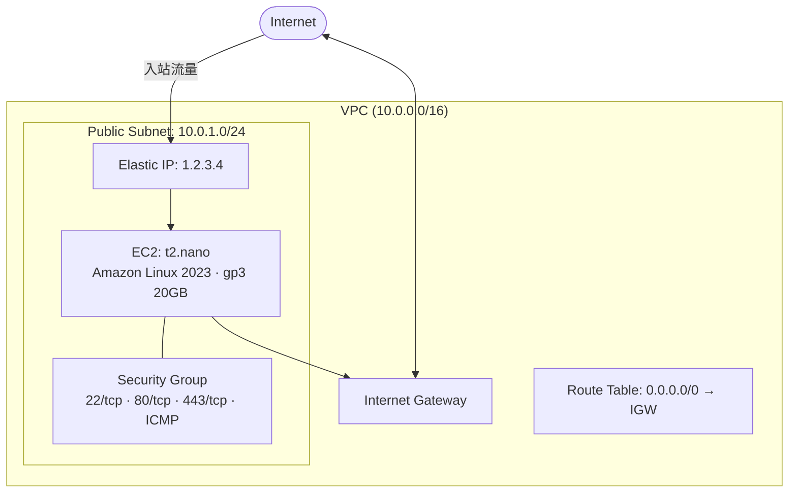

## 什么是 OpenTofu

OpenTofu 是 Terraform 的开源分支，用于以**声明式**的方式管理云基础设施（IaC，Infrastructure as Code）。

与 AWS CLI 的区别：

|          | OpenTofu                    | AWS CLI                |
| -------- | --------------------------- | ---------------------- |
| 方式     | 声明式（描述终态）          | 命令式（执行具体操作） |
| 状态管理 | 有 state 文件，追踪资源状态 | 无状态                 |
| 典型场景 | 创建/销毁一整套基础设施     | 查询、临时操作         |

OpenTofu 和 AWS CLI 都直接调用 AWS API，不存在封装关系。

## 核心概念

### Provider

Provider 是 OpenTofu 操作各家云服务的插件，`tofu init` 时自动下载。

```hcl
required_providers {
  aws = {
    source  = "hashicorp/aws"
    version = "~> 5.0"
  }
}
```

### Resource vs Data Source

- `resource` — 创建资源（EC2、VPC、安全组等）
- `data` — 查询已有信息，不创建资源

```hcl
# 查询最新的 Amazon Linux 2023 AMI（不创建资源）
data "aws_ami" "al2023" {
  most_recent = true
  owners      = ["137112412989"]
  filter {
    name   = "name"
    values = ["al2023-ami-2023.*-x86_64"]
  }
}

# 创建 EC2 实例（使用上面查到的 AMI ID）
resource "aws_instance" "server" {
  ami           = data.aws_ami.al2023.id
  instance_type = "t2.nano"
}
```

### Variables

变量分两个文件：

- `variables.tf` — 声明变量（提交 git）
- `terraform.tfvars` — 存放实际值，如密钥（加入 `.gitignore`）

```hcl
# variables.tf
variable "ssh_public_key" {
  type = string
}

# terraform.tfvars
ssh_public_key = "ssh-ed25519 AAAA..."
```

### State 文件

State 文件（`terraform.tfstate`）是 OpenTofu 的核心机制，记录了"现实世界"中已创建的资源状态。

**State 文件的作用：**

- **追踪资源状态**：记录云上实际创建了哪些资源、它们的 ID 和属性
- **计算增量变更**：`tofu plan` 对比 `.tf` 配置、State 文件、云上实际资源，只变更差异部分
- **存储资源 ID**：保存 AWS 返回的各种 ID，供其他资源引用（如 `aws_vpc.main.id`）
- **防止重复创建**：标记已存在的资源，避免重复创建

**State 文件格式：**

State 文件是 JSON 格式，人类可读，但不建议手动编辑：

```json
{
  "version": 4,
  "serial": 12,
  "lineage": "a1b2c3d4-...",
  "resources": [
    {
      "type": "aws_instance",
      "name": "server",
      "instances": [
        {
          "attributes": {
            "id": "i-0abc123def456",
            "instance_type": "t2.nano",
            "public_ip": "54.199.1.2"
          }
        }
      ]
    }
  ]
}
```

| 字段        | 说明                                                 |
| ----------- | ---------------------------------------------------- |
| `version`   | state 格式版本（目前是 4）                           |
| `serial`    | 每次修改递增，用于检测并发冲突                       |
| `lineage`   | 唯一标识这套 state 的 UUID，防止混用不同环境的 state |
| `resources` | 所有被管理资源的完整属性快照                         |

**操作 State 的命令：**

```bash
# 列出所有受管资源
tofu state list

# 查看某个资源的详细 state
tofu state show aws_instance.server

# 从 state 中移除资源记录（不删除云上资源）
tofu state rm aws_instance.server

# 将已有的云资源导入到 state
tofu import aws_instance.server i-0abc123def456
```

⚠️ State 文件可能包含**明文敏感信息**（数据库密码、私钥等），不能提交 git。

### State 文件与 AI Agent 状态的类比

OpenTofu 的 State 文件与 AI Agent 框架（如 LangGraph）中的状态文件有相似的设计思想——**都在记录「已完成的事」，让系统知道当前世界的状态，从而决定下一步做什么**。

|          | OpenTofu State                   | AI Agent 状态                      |
| -------- | -------------------------------- | ---------------------------------- |
| 记录什么 | 云上已创建的资源及其 ID/属性     | 已执行的步骤、中间结果、上下文     |
| 核心作用 | 对比 `.tf` 配置与现实，计算 diff | 对比目标任务与进度，决定下一步行动 |
| 幂等性   | 防止重复创建资源                 | 防止重复执行已完成的步骤           |
| 可恢复性 | 重新 `apply` 可从中断处继续      | Agent 崩溃后可从上次状态继续       |

两者都在解决同一个核心问题：**当前状态**（current state）与**目标状态**（desired state）之间的 gap。OpenTofu 用 `plan` 计算这个 gap，AI Agent 用 reasoning/planning 计算这个 gap，再分别用 `apply` 或 tool call 来填补它。这正是 [ReAct 框架](https://arxiv.org/abs/2210.03629)（Reason + Act）与声明式 IaC 在架构思想上的同构：**声明终态，追踪当前态，循环直到收敛**。

### Backend

Backend 配置 State 文件的存放位置，推荐存到 S3 而非本地，多台机器可共用且不怕丢失：

```hcl
backend "s3" {
  bucket = "my-tofu-state"
  key    = "aws/ec2/terraform.tfstate"
  region = "ap-southeast-1"
}
```

建议同时开启 S3 服务端加密（SSE），保护 state 中的敏感数据。

## 目录结构

```
ec2-tokyo/
├── providers.tf      # provider 声明、backend、region
├── variables.tf      # 变量声明
├── terraform.tfvars  # 变量实际值（不提交 git）
├── main.tf           # 资源定义
└── outputs.tf        # apply 完成后输出的信息
```

## 在东京创建 EC2

### 架构



### 网络资源

VPC 由以下资源组成：

```hcl
# VPC
resource "aws_vpc" "main" {
  cidr_block = "10.0.0.0/16"
}

# 公有子网
resource "aws_subnet" "public" {
  vpc_id            = aws_vpc.main.id
  cidr_block        = "10.0.1.0/24"
  availability_zone = "ap-northeast-1a"
}

# Internet Gateway：VPC 的网络出口，没有它流量出不去
resource "aws_internet_gateway" "igw" {
  vpc_id = aws_vpc.main.id
}

# 路由表：告诉子网内流量如何转发
resource "aws_route_table" "public" {
  vpc_id = aws_vpc.main.id
  route {
    cidr_block = "0.0.0.0/0"
    gateway_id = aws_internet_gateway.igw.id
  }
}

# 路由表关联到子网
resource "aws_route_table_association" "public" {
  subnet_id      = aws_subnet.public.id
  route_table_id = aws_route_table.public.id
}
```

### 安全组

安全组相当于防火墙规则，`vpc_id` 必须指定，否则会尝试使用默认 VPC：

```hcl
resource "aws_security_group" "server" {
  vpc_id = aws_vpc.main.id

  ingress { from_port = 22;  to_port = 22;  protocol = "tcp";  cidr_blocks = ["0.0.0.0/0"] }
  ingress { from_port = 80;  to_port = 80;  protocol = "tcp";  cidr_blocks = ["0.0.0.0/0"] }
  ingress { from_port = 443; to_port = 443; protocol = "tcp";  cidr_blocks = ["0.0.0.0/0"] }
  ingress { from_port = -1;  to_port = -1;  protocol = "icmp"; cidr_blocks = ["0.0.0.0/0"] }  # ping
  egress  { from_port = 0;   to_port = 0;   protocol = "-1";   cidr_blocks = ["0.0.0.0/0"] }
}
```

ICMP 的 `from_port = -1` 和 `to_port = -1` 表示允许所有 ICMP 类型。

### Elastic IP

EC2 默认公网 IP 重启后会变，Elastic IP 是固定的静态公网 IP：

```hcl
resource "aws_eip" "server" {
  instance = aws_instance.server.id
  domain   = "vpc"
}
```

费用说明：EIP 绑定在**运行中**的实例上免费，实例停止或 EIP 未绑定时收费（约 $0.005/小时）。

## AMI

AMI（Amazon Machine Image）是虚拟机镜像，相当于装系统的 ISO。

用 `data "aws_ami"` 动态查询最新镜像，避免硬编码 AMI ID（AMI ID 各区域不同，且会更新）：

```hcl
data "aws_ami" "al2023" {
  most_recent = true
  owners      = ["137112412989"]  # Amazon 官方
  filter {
    name   = "name"
    values = ["al2023-ami-2023.*-x86_64"]
  }
}
```

Amazon Linux 2023 vs Ubuntu：

|          | Amazon Linux 2023 | Ubuntu 24.04 |
| -------- | ----------------- | ------------ |
| 包管理器 | dnf               | apt          |
| 登录用户 | ec2-user          | ubuntu       |
| 特点     | AWS 优化，启动快  | 生态更广     |

## 常用命令

```bash
# 初始化（首次或更换 provider 后）
tofu init

# 预览变更（不实际执行）
tofu plan

# 应用变更
tofu apply

# 销毁所有资源
tofu destroy

# 查看当前 state
tofu show

# 查看输出值
tofu output
```

### tofu init 做了什么

`tofu init` 是本地的准备工作：把这个目录需要的东西备齐。它不调用云厂商 API，不创建、修改或删除任何资源，也不改 state 的内容。可以重复执行，结果一样。

按顺序做四件事：

1. 初始化 backend。读取 `backend` 块，确认 state 存在哪里（本地文件或 S3 等），能不能连上，然后把 backend 配置缓存到 `.terraform/terraform.tfstate`。这个文件只是「state 在哪」的记录，不是真正的 state。
2. 下载模块。配置里有 `module` 块且 `source` 指向远程时，把模块代码下载到 `.terraform/modules/`。
3. 安装 provider。读取 `required_providers` 和 `.terraform.lock.hcl`，把对应版本、对应平台的插件下载到 `.terraform/providers/`。
4. 写依赖锁文件。第一次 init 时生成 `.terraform.lock.hcl`，记录每个 provider 的确切版本和校验和。以后再 init，就按锁文件装同一个版本，换机器也一样。

init 之后目录里多出来的东西，以一个 Stripe 配置目录为例：

```text
infra/stripe/opentofu/enx/
├── .terraform.lock.hcl          # provider versions + hashes, commit to git
└── .terraform/                  # local cache, do not commit
    ├── terraform.tfstate        # where the real state lives (backend config)
    ├── environment              # currently selected workspace, e.g. "live"
    └── providers/
        └── registry.opentofu.org/stripe/stripe/0.1.3/darwin_arm64/
```

`.terraform/` 删掉也没关系，重新 init 就会恢复。真正的 state 在 backend 里（这里是 S3），不在这个目录。

#### 什么时候需要重新 init

- 第一次克隆仓库，或者换了一台机器。
- 改了 `required_providers` 的版本，或者加了新的 provider、新的 module。
- 改了 `backend` 配置。

如果需要 init 却没跑，`tofu plan` 会直接报错提示先 init，不会带着缺失的插件往下走。

#### 唯一要留意的提示

backend 配置变了之后再 init，它会问要不要把已有的 state 复制到新 backend：

```text
Do you want to copy existing state to the new backend?
```

这是 init 唯一会动到 state 的情况，而且会先问你。没想清楚就回答 no。

#### 常用参数

```bash
# Upgrade providers to the newest version allowed by the constraints, and rewrite the lock file
tofu init -upgrade

# Backend config changed: start fresh with the new config, do not migrate state
tofu init -reconfigure

# Backend config changed: copy the existing state to the new backend
tofu init -migrate-state

# Install providers only, skip the backend (e.g. for tofu validate in CI)
tofu init -backend=false

# Fail instead of updating the lock file (CI)
tofu init -lockfile=readonly
```

### workspace：一份配置，多套 state

workspace 让同一份 `.tf` 配置对应多套互相隔离的 state，常用来区分测试和生产。比如 Stripe 的配置，`default` 对应 Sandbox，`live` 对应正式环境。

```bash
# Show the current workspace
tofu workspace show

# List all workspaces, the current one is marked with *
tofu workspace list

# Switch workspace
tofu workspace select live

# Create a new workspace
tofu workspace new live
```

当前选中的 workspace 记在 `.terraform/environment` 里，跨终端、跨天都有效。上次切到 `live` 没切回来，下次打开终端它还是 `live`。所以 `plan` 之前先 `tofu workspace show` 确认一下，同时确认环境变量里的密钥（比如 `STRIPE_API_KEY`）和 workspace 对得上。

#### tofu workspace select 做了什么

`tofu workspace select default` 只做一件事：把「当前 workspace」切换成 `default`，也就是把 `.terraform/environment` 改成 `default`（`default` 时这个文件可能直接被删掉，效果一样）。它不读也不改任何资源，不改 state 内容，不调用云厂商 API。

切换之后，后面的 `plan`、`apply`、`state list` 等命令读写的就是 `default` 那一套 state。

`default` 有两点特殊：

- 它永远存在，不用创建，也删不掉。
- 没用过 workspace 的项目其实一直都在 `default` 里。

用 S3 backend 时，不同 workspace 的 state 放在桶里不同的路径：

| workspace | S3 里的 state 路径 |
| --------- | ------------------ |
| `default` | `<key>`，即 backend 块里写的 `key` |
| 其他，如 `live` | `env:/live/<key>` |

`env:` 是默认前缀，可以用 backend 的 `workspace_key_prefix` 改。所以切换 workspace 实际上是在换「读写桶里哪个文件」。

另外两种情况：

```bash
# Select a workspace that does not exist yet: error, unless -or-create
tofu workspace select -or-create staging

# TF_WORKSPACE overrides the selected workspace for this shell only
TF_WORKSPACE=live tofu plan
```

`TF_WORKSPACE` 适合在 CI 里用，不依赖 `.terraform/environment`。本地手动操作时还是用 `select` 加 `show` 更直观。

### tofu plan 输出说明

`tofu plan` 用符号标识每个资源的变更类型：

| 符号  | 含义                         |
| ----- | ---------------------------- |
| `+`   | 新增资源                     |
| `~`   | 原地修改资源（资源不会重建） |
| `-`   | 删除资源                     |
| `-/+` | 先删除再重建（破坏性变更）   |

**新增资源（`+`）**

```
OpenTofu will perform the following actions:

  # aws_instance.server will be created
  + resource "aws_instance" "server" {
      + ami           = "ami-0abcdef1234567890"
      + instance_type = "t2.nano"
      + id            = (known after apply)
      + public_ip     = (known after apply)
    }

Plan: 1 to add, 0 to change, 0 to destroy.
```

**修改资源（`~`）**

将 `instance_type` 从 `t2.nano` 改为 `t2.micro` 时：

```
  # aws_instance.server will be updated in-place
  ~ resource "aws_instance" "server" {
        id            = "i-0abc123def456"
      ~ instance_type = "t2.nano" -> "t2.micro"
    }

Plan: 0 to add, 1 to change, 0 to destroy.
```

**删除资源（`-`）**

从 `.tf` 文件中移除某个资源块时：

```
  # aws_eip.server will be destroyed
  - resource "aws_eip" "server" {
      - id          = "eipalloc-0abc123" -> null
      - public_ip   = "54.199.1.2" -> null
      - instance    = "i-0abc123def456" -> null
    }

Plan: 0 to add, 0 to change, 1 to destroy.
```

**先删后建（`-/+`）**

修改了不支持原地更新的属性（如 AMI ID）时，OpenTofu 会销毁旧资源再重建：

```
  # aws_instance.server must be replaced
-/+ resource "aws_instance" "server" {
      ~ id  = "i-0abc123def456" -> (known after apply)
      ~ ami = "ami-0000000000000001" -> "ami-0abcdef1234567890" # forces replacement
    }

Plan: 1 to add, 0 to change, 1 to destroy.
```

⚠️ `-/+` 变更会造成服务中断，执行前需格外注意。

## 踩坑记录

### 区域没有默认 VPC

**错误**：`No default VPC for this user`

**原因**：安全组没有指定 `vpc_id`，OpenTofu 尝试使用默认 VPC，但该区域没有默认 VPC。

**解决**：创建自己的 VPC，在安全组里指定 `vpc_id = aws_vpc.main.id`。

### IAM 权限不足

**错误**：`You are not authorized to perform: ec2:DescribeImages`

**原因**：`tofu-deploy` IAM 用户缺少 EC2 相关权限。

**解决**：在 AWS 控制台给该用户附加 `AmazonEC2FullAccess` 策略。

## 维护记录

| 日期       | 内容                                                         |
| ---------- | ------------------------------------------------------------ |
| 2026-10-19 | 新增「tofu init 做了什么」和「workspace：一份配置，多套 state」两节，说明 `tofu workspace select` 和 S3 里各 workspace 的 state 路径 |
